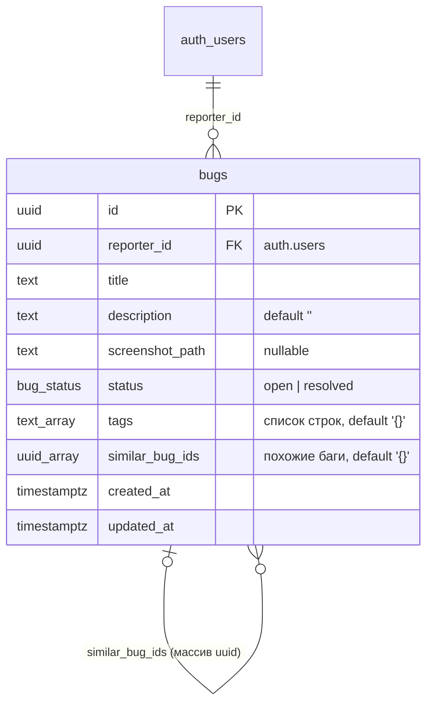

# BugTrace — архитектура

> Дополняет `PRD.md`. Минимальная схема: одна таблица `bugs` + один приватный bucket.
> Теги, похожесть и AI-результаты живут прямо на баге; роль — в JWT; права — RLS.

## 1. Стек

| Слой | Технология |
|---|---|
| Frontend + API | Next.js (App Router, TS), Route Handlers = REST API |
| БД | Supabase (PostgreSQL) через supabase-js; миграции — SQL |
| Auth | Supabase Auth (email + пароль); роль — в JWT `app_metadata.role` |
| Файлы | Supabase Storage, приватный bucket `bug-screenshots` |
| AI | OpenRouter через API-роут: описание по скрину (vision), теги (JSON), похожесть (pg_trgm в БД) |

## 2. Роли

Роль хранится в `app_metadata` пользователя Supabase (менять её может только сервер/admin —
пользователь себя повысить не может) и приезжает в каждом JWT:

- `user` — видит свои баги (любые) и все решённые.
- `moderator`, `admin` — видят все баги, правят контент и статусы, видят список похожих.
- Удаляет только admin. Раздача ролей — через Supabase Dashboard / admin API (вне UI v1).

Проверка staff в SQL: `(auth.jwt() -> 'app_metadata' ->> 'role') IN ('moderator','admin')`.

## 3. Сущности

Одна таблица. Теги — массив строк; похожесть — массив id других багов; AI-результаты —
колонки на баге.



### 3.1 SQL

```sql
CREATE TYPE bug_status AS ENUM ('open', 'resolved');

CREATE TABLE public.bugs (
    id              uuid PRIMARY KEY DEFAULT gen_random_uuid(),
    reporter_id     uuid NOT NULL REFERENCES auth.users (id),
    title           text NOT NULL,
    description     text NOT NULL DEFAULT '',
    screenshot_path text,                          -- '{bug_id}/{uuid}.{ext}'
    status          public.bug_status NOT NULL DEFAULT 'open',
    tags            text[]  NOT NULL DEFAULT '{}', -- «auth», «ui», …
    similar_bug_ids uuid[]  NOT NULL DEFAULT '{}', -- AI-похожесть, без score
    created_at      timestamptz NOT NULL DEFAULT now(),
    updated_at      timestamptz NOT NULL DEFAULT now()
);

CREATE INDEX bugs_reporter_idx ON public.bugs (reporter_id);
CREATE INDEX bugs_status_idx   ON public.bugs (status);
CREATE EXTENSION IF NOT EXISTS pg_trgm;
CREATE INDEX bugs_search_idx ON public.bugs USING gin ((title || ' ' || description) gin_trgm_ops);
```

Статусы только `open` → `resolved`. Правила «3–200 символов», уникальность и нормализация
тегов (lowercase, без дублей), переходы статусов — ответственность API, не БД.
`updated_at` выставляет API.

## 4. RLS-политики

```sql
ALTER TABLE public.bugs ENABLE ROW LEVEL SECURITY;

-- видят: автор — свои; все — решённые; staff — все
CREATE POLICY bugs_select ON public.bugs FOR SELECT TO authenticated
    USING (
        reporter_id = auth.uid()
        OR status = 'resolved'
        OR (auth.jwt() -> 'app_metadata' ->> 'role') IN ('moderator', 'admin')
    );

-- создать может только «от себя»
CREATE POLICY bugs_insert ON public.bugs FOR INSERT TO authenticated
    WITH CHECK (reporter_id = auth.uid());

-- менять — только staff (resolve / правка контента)
CREATE POLICY bugs_update ON public.bugs FOR UPDATE TO authenticated
    USING ((auth.jwt() -> 'app_metadata' ->> 'role') IN ('moderator', 'admin'));

-- удалять — только admin
CREATE POLICY bugs_delete ON public.bugs FOR DELETE TO authenticated
    USING ((auth.jwt() -> 'app_metadata' ->> 'role') = 'admin');
```

Аноним — ничего (нет политики для anon). Роли в таблице БД нет → нет рекурсии политик →
не нужны helper-функции.

### Негативные тесты

1. B не видит нерешённый баг A (0 строк), решённый — видит.
2. A не может вставить баг с чужим `reporter_id` → `42501`.
3. A не может обновить баг (даже свой) → `42501`; moderator — может.
4. A (user) не может удалить → `42501`; admin — может.
5. A не скачивает скриншот чужого нерешённого бага из storage.
6. Anon без JWT не видит ничего.

## 5. Storage

Приватный bucket `bug-screenshots`, ключ `{bug_id}/{uuid}.{ext}`, PNG/JPEG/WebP ≤ 5 МБ.
Две политики, зеркалят видимость бага (первая часть пути = bug_id):

```sql
-- загрузка: только автор бага
CREATE POLICY "screenshots_insert" ON storage.objects FOR INSERT TO authenticated
    WITH CHECK (
        bucket_id = 'bug-screenshots'
        AND EXISTS (
            SELECT 1 FROM public.bugs b
            WHERE b.id = ((storage.foldername(name))[1])::uuid
              AND b.reporter_id = auth.uid()
        )
    );

-- чтение: автор, staff, либо баг решён
CREATE POLICY "screenshots_select" ON storage.objects FOR SELECT TO authenticated
    USING (
        bucket_id = 'bug-screenshots'
        AND EXISTS (
            SELECT 1 FROM public.bugs b
            WHERE b.id = ((storage.foldername(name))[1])::uuid
              AND (b.reporter_id = auth.uid()
                   OR b.status = 'resolved'
                   OR (auth.jwt() -> 'app_metadata' ->> 'role') IN ('moderator','admin'))
        )
    );
```

Отдача на фронт — `GET /api/bugs/{id}/screenshot` → short-lived signed URL.

## 6. AI — один вызов API, результат на баге

Операции в БД не хранятся. Один серверный роут:

```
POST /api/bugs/{id}/ai        # staff; перезапуск вручную
```

Пайплайн по порядку, пишет результат прямо в колонки бага:

1. **Описание по скрину** — если `screenshot_path` есть, а `description` пуст → OpenRouter
   vision → `bugs.description`.
2. **Теги** — OpenRouter с JSON-схемой `{"tags": string[]}` (≤ 5 строк, lowercase) → `bugs.tags`.
3. **Похожие** — pg_trgm по `title + description` среди остальных багов (решённых и нет),
   top-5 id → `bugs.similar_bug_ids` (без score).

Сбой шага не мешает следующим; при полном сбое баг просто остаётся без AI-полей.
После создания бага `POST /api/bugs` запускает этот же пайплайн автоматически (fire-and-forget).

**Лимиты** — в коде API, без таблицы: не более 5 запусков на баг и N запросов в минуту
на сервер (счётчик в памяти процесса). Отказ → `429`.

## 7. Поверхность API

| Метод и путь | Кто | Что |
|---|---|---|
| `POST /api/bugs` | authenticated | создать; дальше сам запускает AI-пайплайн |
| `GET /api/bugs` | authenticated | свои + решённые; staff — все. `?status=&q=&tag=&page=` |
| `GET /api/bugs/{id}` | по видимости | баг; **`similar_bug_ids` отдаётся только staff, остальным — `null`** |
| `PATCH /api/bugs/{id}` | staff | правка title/description/tags; `status → resolved` |
| `DELETE /api/bugs/{id}` | admin | удалить |
| `POST /api/bugs/{id}/screenshot` | автор | загрузка скрина |
| `GET /api/bugs/{id}/screenshot` | по видимости | signed URL |
| `POST /api/bugs/{id}/ai` | staff | перезапуск AI-пайплайна |

Видимость решает RLS (API получает уже отфильтрованные строки; невидимый id → 404).
Ссылки на похожие скрывает API (колонку массива нельзя спрятать политикой по строке) —
это единственное правило доступа, живущее не в RLS. CORS — белый список origins в `middleware.ts`.

## 8. Миграции

1. `0001_init.sql` — расширение pg_trgm, enum, таблица, индексы.
2. `0002_rls.sql` — RLS-политики таблицы + bucket и его политики.
3. `0003_seed.sql` (опционально) — тестовые пользователи (user/moderator/admin через admin API)
   и баги во всех статусах.
