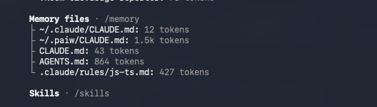

# О проекте и агентной инфраструктуре

## Стек

| Слой | Технология |
|------|------------|
| UI | React 19 + Vite 8 (JavaScript, без TS/роутера/state-менеджера) |
| Юнит-тесты | Vitest 5 + Testing Library (`jsdom`, `user-event`, `jest-dom`) — `src/*.test.jsx` |
| Browser e2e | Playwright (Chromium) — `e2e/login.spec.js`, скрипт `npm run test:e2e` |
| Линтер | ESLint, конфиг airbnb |
| Агент | Claude Code: permissions, hooks, path-правила, skills, chrome-devtools MCP |

## Path-правило (эксперимент)

`.claude/rules/js-ts.md` — правило код-стайла с frontmatter-полем `globs: **/*.{js,jsx,ts,tsx}`: загружается в контекст агента только при работе с файлами, попадающими под маску.

- **Задача A (путь под globs):** правка `src/pages/LoginPage.jsx` — правило активно: агент следует конвенциям (стрелочные функции, `const`, `===`, шаблонные строки) и после правок JS запускает `npm run build` (требование секции «Проверка перед коммитом» правила).
- **Задача B (соседний путь вне globs):** правка `README.md` — правило не загружается, js-ts-конвенции на markdown не действуют.

Проверить видимость правила можно командой `/context`: при работе с jsx-файлами `js-ts.md` присутствует в списке загруженных правил, при работе с md — нет.

## Skills

Шесть skills в `.claude/skills/` (из [mattpocock/skills](https://github.com/mattpocock/skills), фиксация в `skills-lock.json`):

| Skill | Назначение |
|-------|------------|
| `code-review` | ревью диффа по двум осям: стандарты репозитория и соответствие спеке (параллельные субагенты) |
| `grill-me` | «безжалостное» интервью для заострения плана/дизайна |
| `implement` | реализация задачи по спеке/тикетам |
| `research` | исследование вопроса по первоисточникам фоновым агентом |
| `tdd` | test-driven development: red → green → refactor |
| `wayfinder` | планирование большого объёма работ как карты decision-тикетов |

## Права и режим по умолчанию

Политика в `.claude/settings.json` → `permissions`:

| Режим | Правила | Зачем |
|-------|---------|-------|
| **allow** | `Bash(npm run *)`, `Bash(npm test *)`, `Bash(npx playwright test*)`, `Bash(npx eslint *)`, `Bash(git add *)`, `Bash(git commit*)` | рутина: тесты, линтер, сборка, локальный коммит — без трения |
| **ask** | `Bash(git push)`, `Bash(npm install *)`, `Bash(npx playwright install*)` | действия наружу (push) и смена зависимостей — только с подтверждением |
| **deny** | `Read/Edit(.env*)`, `Bash(rm -rf *)` | секреты и необратимое удаление — запрещены безусловно |

Режим по умолчанию — `default`: любое действие, не попавшее в allow, требует подтверждения пользователя. Обоснование — в [README](../README.md#как-агент-работает-в-проекте).

## Hooks

1. **PostToolUse** (`Write|Edit`): `eslint --fix` на изменённом js/ts-файле — стайл чинится автоматически сразу после записи.
2. **PreToolUse** (`Write|Edit|NotebookEdit`): `.claude/hooks/protect-paths.sh` — блокирует запись в `.env` / `.env.*` (exit 2, агент видит сообщение об отказе). Дубль deny-правил намеренный: defense in depth.
3. **PreToolUse** (`Bash`): `gsd-validate-commit.sh` — энфорсит Conventional Commits для `git commit` (exit 2 на невалидном сообщении). Opt-in через `hooks.community: true` в `.planning/config.json`.
4. **SessionStart**: `gsd-session-state.sh` — инжектит голову `.planning/STATE.md` в контекст каждой сессии (ориентация: текущая фаза, прогресс, блокеры).

## GSD (Git. Ship. Done.)

[GSD](https://github.com/) v1.18.0 в `.claude/gsd-core/` + 80+ команд `/gsd-*` и 40+ субагентов в `.claude/commands/` / `.claude/agents/`:

- Discovery пройден (`/gsd-new-project --auto`): `.planning/` — PROJECT / REQUIREMENTS (6 REQ) / ROADMAP (4 фазы) / STATE + research-документы, написанные 4 параллельными субагентами.
- Режимы: yolo / coarse / parallel / adaptive (`.planning/config.json`).
- Управление контекстом: `gsd-context-monitor.js` (context_warnings) — предупреждения о заполнении контекста.

## Память (docs/memory.md)

Память между сессиями ведёт ручной журнал `docs/memory.md` (агент читает историю в начале работы и дописывает результаты в конце):

- Запись — строка таблицы: дата, что сделано, что дальше.
- Эксперимент с плагином claude-mem (SessionStart-инъекция / SessionEnd-сохранение) отменён в тот же день, 2026-10-23: компрессии наблюдений нужен внешний AI-провайдер с учётными данными, а журнал самодостаточен и полностью локален.
- Демо-кейс: «ложнозелёный `npm run lint`» (находка Discovery) зафиксирован в журнале; при живой проверке 2026-10-23 не воспроизвёлся (`eslint .` линтил `.jsx`, нашёл 7 ошибок) — корректирующая запись тоже в журнале. Это и есть рабочий цикл памяти: наблюдение → проверка → корректировка.

## Быстрые команды

- `/check` (`.claude/commands/check.md`) — полная проверка: `npm run build` → `npm test` → `npm run lint` + страховка `npx eslint src/ --ext .js,.jsx` (обход известного ложнозелёного кейса).

## Управление контекстом (/compact)

Сценарий проверки компакции (hw-2, п.3 плана):

1. Свежая сессия, контекст нагружен (GSD-фазы, чтение больших файлов).
2. `/context` до компакции — снимок №1: что в контексте, сколько токенов.
3. `/compact instructions` — компакция с сохранением фокуса текущей задачи.
4. `/context` после — снимок №2, сравнение токенов.

| Момент | Скрин | Токены (заполнить) |
|--------|-------|--------------------|
| До `/compact` | `assets/context-before.png` | TODO |
| После `/compact instructions` | `assets/context-after.png` | TODO |

<!-- TODO(hw-2): положить context-before.png / context-after.png в docs/assets/ и вписать числа токенов до/после; краткий вывод (что сохранила компакция, что потеряла) — сюда. -->

## MCP UI-сценарий (chrome-devtools)

Сценарий пройден агентом через chrome-devtools MCP на dev-сервере (`http://localhost:5173`):

1. `new_page` → открытие приложения; `take_snapshot` → дерево доступности: заголовок «Вход», поля Email/Пароль, кнопка «Войти».
2. Клик «Войти» с пустыми полями → в snapshot появился `alert` «Заполните email и пароль».
3. `fill` Email (`user@example.com`) и Пароль → клик «Войти» → alert исчез.
4. `list_console_messages` → в консоли `login { email }` (заглушка авторизации сработала).
5. `take_screenshot` → `assets/e2e-page.png`.

Тот же сценарий зафиксирован зелёным Playwright-тестом `e2e/login.spec.js` (2 теста).

## Скриншоты

| Скрин | Файл | Что показывает |
|-------|------|----------------|
| Отказ `.env` | `assets/env-deny.png` | deny-правило + PreToolUse-hook блокируют чтение/запись `.env` |
| Линтер | `assets/lint-hook.png` | PostToolUse-хук `eslint --fix` чинит стайл после записи файла |
| Память | `assets/memory-session2.png` | агент во второй сессии продолжает работу по `docs/memory.md` |
| Зелёный e2e | `assets/e2e-green.png` | `npm run test:e2e` — 2 passed |

Дополнительно: `assets/e2e-page.png` — скриншот страницы из MCP-сценария.
